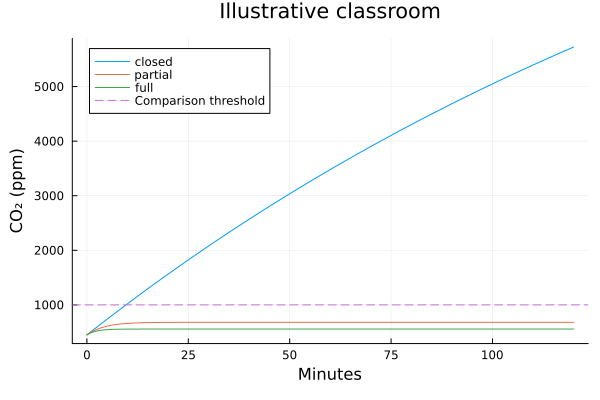

# Classroom Ventilation Explorer

Explore how window opening affects classroom CO₂ and air temperature using a reproducible single-zone simulation.

[](https://colab.research.google.com/drive/12tRdhrRquj53lTTo7m3MX0h7QMUEX5j4?usp=sharing) [](https://kaveensathurusinghe.github.io/classroom-ventilation/)

**[Open the shared Colab notebook](https://colab.research.google.com/drive/12tRdhrRquj53lTTo7m3MX0h7QMUEX5j4?usp=sharing)** · **[Repository notebook](notebook/classroom-ventilation.ipynb)** · **[User guide](USER_GUIDE.md)** · **[Model and equations](THEORY.md)**

For offline use, download the repository and open [docs/index.html](docs/index.html) locally. GitHub's file preview does not run the demo.



## Problem and question

Which of closed, half-open and fully open windows controls CO₂ without excessive air-temperature discomfort in an illustrative naturally ventilated classroom in Sri Lanka?

## Quick start

### Run in Google Colab

1. Open the **Open in Colab** button above. Sign in to Google if prompted. Save a copy to your Drive if you want to retain your own edits and outputs.
2. Choose a **Julia** runtime under **Runtime → Change runtime type**. The simulation cells contain Julia code.
3. Select **Runtime → Run all**, starting with the setup cell. Wait for dependency installation and compilation before interpreting later outputs.
4. Check the printed Julia version and verification results, then inspect the deterministic plots, Monte Carlo summaries and paired comparisons.
5. Save the completed notebook and download any generated results you need before the runtime disconnects.

The setup prints `NOTEBOOK_ROOT`, identifying its temporary working directory. The final cell exports plots, tables, sampled inputs, outcomes and refinement records into that directory's `results/` folder by default. Runtime files are temporary and are not automatically committed to this repository. The shared Drive notebook and repository notebook are separate copies; edits do not automatically synchronise.

Standard runs use embedded frozen weather, so no API key or separate weather download is needed. Initial dependency installation needs internet access. Keep installation enabled on a fresh runtime.

The revised notebook uses a bundled Julia SVG chart renderer instead of Plots/GR/Qt. Its pinned manifest has 41 entries rather than 173, with no native graphics stack. Automatic package precompilation is disabled, and the small project wrapper loads from source to avoid repeated wrapper-cache compilation against kernel-loaded dependencies. The first cell prints `SETUP_SECONDS`; the final cell prints `TOTAL_NOTEBOOK_SECONDS`, including installation, verification, all 500 scenarios and exports. A fresh Colab timing of this revised version is still required; an earlier version exceeded ten minutes in setup. Downloaded/shared Drive notebooks do not update automatically when this repository changes.

### Run locally

Clone the project, or use GitHub's **Code → Download ZIP** and extract the download:

```sh
git clone https://github.com/kaveensathurusinghe/classroom-ventilation.git
cd classroom-ventilation
```

Use Julia 1.12 or later (verified locally with 1.12.7). Open `notebook/classroom-ventilation.ipynb` with a Julia notebook kernel locally, or upload it to a Julia Colab runtime, then run its cells from top to bottom.

The first code cell prints Julia's version, unpacks the embedded Julia source and frozen weather into a temporary project, and installs dependencies. The root `Project.toml` and `Manifest.toml` describe that embedded environment. No repository URL or machine-specific input path is needed. An owner-executed Colab export reviewed on 26 November shows completed calculations on Julia 1.12.6, 302 passing tests and 500 paired scenarios. Setup completed with dependency-version and precompilation diagnostics; total elapsed time and free-tier status were not recorded, so the ten-minute target remains unverified. See [the evidence review](notebook/VERIFICATION.md).

The saved notebook includes outputs from a local sequential Julia replay using preinstalled dependencies; that run does not verify fresh installation or Colab execution.

Double-click `docs/index.html` for the offline demo; no server, key or CDN is required. See [USER_GUIDE.md](USER_GUIDE.md).

For local notebook execution, use a Julia-capable Jupyter or VS Code notebook environment and select its Julia kernel. The notebook is the public simulation entry point; opening a Julia terminal at the repository root does not run the experiments. If a later cell reports missing variables or modules, restart the kernel and execute from the first cell. Resolve setup errors before proceeding. On Windows, check that the kernel points to the actual installed Julia executable if the `julia` command fails.

### Explore the browser demo

1. Open `docs/index.html` in Chrome, Edge or Firefox. Keep `script.js`, `style.css` and `reference.js` alongside it.
2. Set **occupants**, **outdoor temperature** and **wind speed**.
3. Press **Reset** to apply settings, then **Start** to animate all three window strategies.
4. Use **Pause** and **Start** to pause and resume. Read the CO₂/temperature plots and peak/threshold-duration table.
5. Let the simulation reach **120 minutes** for full-lecture metrics. During playback, metrics cover elapsed time only.
6. Use **Check Julia reference** to compare the default browser calculation with saved Julia reference values, independently of the slider settings.

Try 35 occupants, 29 °C outdoors and 2 m/s wind. Then lower wind to 0.2 m/s or raise occupancy to 45, resetting each time. Compare how ventilation affects both CO₂ accumulation and heat. The demo requires no Julia or Python installation; the notebook provides the stochastic analysis.

## Baseline assumptions

The room is represented as one well-mixed air volume. Occupants generate CO₂ and sensible heat; wind and indoor/outdoor temperature differences drive ventilation. Closed windows retain background infiltration.

| Input | Default |
| --- | --- |
| Room dimensions / volume | 8 × 7 × 3.2 m / 179.2 m³ |
| Occupants / lecture duration | 35 / 2 hours |
| Window-opening fractions | 0, 0.5 and 1 |
| Initial / outdoor CO₂ | 450 / 420 ppm |
| Initial indoor / outdoor temperature | 28 / 29 °C |
| Local wind speed | 2 m/s |
| CO₂ comparison threshold | 1000 ppm |
| Illustrative air-temperature band | 24–30 °C |

These are illustrative assumptions, not measured classroom parameters. Full coefficients, units and distributions are documented in [THEORY.md](THEORY.md) and the [input register](notebook/notes/uncertainty.md).

## Model and mathematics

Two mass/heat-balance ODEs share wind-and-stack ventilation. Manual Euler/RK4 use hours, ppm and °C. See [THEORY.md](THEORY.md) and [notebook/notes/](notebook/notes/).

## Verification

Checks cover analytical decay, step convergence, integrated CO₂ budgets, thermal relaxation, interpolation, random variates and paired sampling. The browser reference check compares JavaScript against exported Julia results. See [verification record](notebook/VERIFICATION.md) for executed checks and remaining work.


### Recheck the saved results

Run these optional commands from the repository root:

```sh
# Node.js: demo reference checks, including malformed reference inputs
node notebook/reference-checks.cjs

# Python standard library: independently reconstruct saved summaries
python notebook/reconstruct-summaries.py

# Python with NumPy and Matplotlib: regenerate sensitivity intervals
python notebook/sensitivity-intervals.py
```

The final command rewrites the sensitivity-interval table, plots and manifest from saved Julia outcomes; it does not rerun simulation trajectories. Recorded checks include 372 reference tests and 825 reconstructed aggregate fields. Numerical agreement is separate from browser layout/control verification.

On the smooth analytical benchmark, finest-grid CO₂ error orders are approximately **1.015 for Euler** and **4.030 for RK4**. Do not generalise these orders to the nonsmooth zero-wind stack-flow crossing. The documented hot/calm demo case has a 15-second peak error of about -0.033743 ppm; see the [accuracy investigation](notebook/notes/hot-calm-accuracy.md).

## Concepts applied

Numerical ODE solvers, inverse-transform random variate generation, Monte Carlo with common random inputs, confidence intervals, conservation and stability checks, and descriptive sensitivity screening.

The [extension evidence assessment](notebook/notes/extension-evidence.md) maps independent verification and measured log-log convergence to X2, and the systematic sensitivity study with new bootstrap intervals to X5. Both remain conditional on qualifying public-release requirements (X1); extension credit is not claimed as complete. Historical weather forcing does not establish X4 calibration or validation.

## Results, limitations and future work

In the rerun default case, closed/half-open/fully open peak CO₂ was approximately 5724/681/557 ppm. Peak air temperature was 54.72/31.96/30.62 °C. Thus opening reduced accumulation under these inputs, but none of the three fixed strategies maintained the illustrative temperature band for the whole lecture. See `figures/tables/` for fresh deterministic and uncertainty summaries.

Results are conditional on assumed classroom parameters. Only air stores heat; rapid warming and high closed-window temperatures can be unrealistic. The 1000 ppm comparison threshold and 24–30 °C band are illustrative, not regulatory limits or a full comfort assessment. No humidity, radiation, wall storage, spatial resolution or empirical calibration is included. Adaptive control remains unimplemented.

Selected result tables and figures live in `figures/`; the notebook generates its own outputs during execution. Frozen inputs and credits: [data/README.md](data/README.md).

The 26 November refresh reran 500 paired scenarios with `Xoshiro(4042)`. CO2 excursions occurred in 500/500 closed, 51/500 partial and 0/500 full-opening cases; all strategies had thermal excursions in every scenario. Zero observed events do not establish zero risk. [Sampling precision and interpretation](notebook/notes/standard-run-20261126.md) report the intervals and limitations. [Saved inputs, per-scenario outcomes and reconstruction instructions](figures/tables/README.md) make the summaries auditable; the notebook now exports these along with all selected plots and tables.

## Repository guide

| Path | Contents |
| --- | --- |
| `notebook/classroom-ventilation.ipynb` | Self-contained Julia model, experiments and verification |
| `notebook/classroom_ventilation-colab-run-results.ipynb` | Saved owner-executed Colab outputs |
| `notebook/VERIFICATION.md` | Execution evidence, tolerances and known limitations |
| `notebook/notes/` | Detailed modelling and analysis notes |
| `docs/` | Offline browser demo and Julia reference data |
| `data/` | Frozen weather, request metadata and derived profiles |
| `figures/` | Selected plots, raw outcomes and summary tables |
| `THEORY.md` | Equations and numerical/statistical methods |
| `USER_GUIDE.md` | Demo instructions and interpretation |
| `REFERENCES.md` | Sources and citation status |
| `Project.toml`, `Manifest.toml` | Julia environment and pinned dependencies |

## Sources

Wind/stack formulation: EnergyPlus Engineering Reference. Occupant generation variability: Persily and de Jonge. Historical weather: Open-Meteo/ERA5. See [REFERENCES.md](REFERENCES.md) for source status.

## AI assistance

The initial Julia implementation was developed with substantial Codex assistance. Codex subsequently reorganized, extended and tested it. The owner's original planning document predates the rebuild. Detailed interaction records and review status stay private. This note does not assert that all original interactions have been recovered or that the owner reviewed every line.

## Licence and data credits

Code: [MIT](LICENSE). Weather retains upstream terms and attribution in `data/README.md`.
