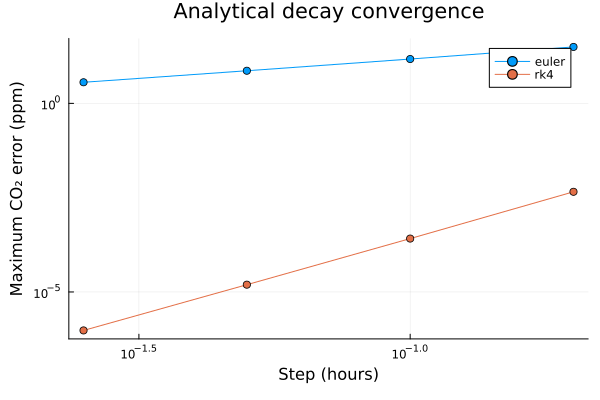

# Classroom Ventilation Explorer

Explore how window opening affects classroom CO₂ and air temperature using a reproducible single-zone simulation.

**Demo:** open [docs/index.html](docs/index.html) locally. Public hosting is not yet configured.
**Notebook:** [classroom-ventilation.ipynb](notebook/classroom-ventilation.ipynb); upload to a Julia Colab runtime. A public badge awaits the final repository URL.

## Problem and question

Which of closed, half-open and fully open windows controls CO₂ without excessive air-temperature discomfort in an illustrative naturally ventilated classroom in Sri Lanka?

## Quick start

Use Julia 1.12 or later (verified locally with 1.12.7). Open `notebook/classroom-ventilation.ipynb` with a Julia notebook kernel locally, or upload it to a Julia Colab runtime, then run its cells from top to bottom.

The first code cell prints Julia's version, unpacks the embedded Julia source and frozen weather into a temporary project, and installs dependencies. The root `Project.toml` and `Manifest.toml` describe that embedded environment. No repository URL or machine-specific input path is needed. An owner-executed Colab export reviewed on 26 November shows completed calculations on Julia 1.12.6, 302 passing tests and 500 paired scenarios. Setup completed with dependency-version and precompilation diagnostics; total elapsed time and free-tier status were not recorded, so the ten-minute target remains unverified. See [the evidence review](notebook/VERIFICATION.md).

The saved notebook includes outputs from a local sequential Julia replay using preinstalled dependencies; that run does not verify fresh installation or Colab execution.

Double-click `docs/index.html` for the offline demo; no server, key or CDN is required. See [USER_GUIDE.md](USER_GUIDE.md).

## Model and mathematics

Two mass/heat-balance ODEs share wind-and-stack ventilation. Manual Euler/RK4 use hours, ppm and °C. See [THEORY.md](THEORY.md) and [notebook/notes/](notebook/notes/).

## Verification

Checks cover analytical decay, step convergence, integrated CO₂ budgets, thermal relaxation, interpolation, random variates and paired sampling. The browser reference check compares JavaScript against exported Julia results. See [verification record](notebook/VERIFICATION.md) for executed checks and remaining work.

## Concepts applied

Numerical ODE solvers, inverse-transform random variate generation, Monte Carlo with common random inputs, confidence intervals, conservation and stability checks, and descriptive sensitivity screening.

The [extension evidence assessment](notebook/notes/extension-evidence.md) maps independent verification and measured log-log convergence to X2, and the systematic sensitivity study with new bootstrap intervals to X5. Both remain conditional on qualifying public-release requirements (X1); extension credit is not claimed as complete. Historical weather forcing does not establish X4 calibration or validation.

## Results, limitations and future work

In the rerun default case, closed/half-open/fully open peak CO₂ was approximately 5724/681/557 ppm. Peak air temperature was 54.72/31.96/30.62 °C. Thus opening reduced accumulation under these inputs, but none of the three fixed strategies maintained the illustrative temperature band for the whole lecture. See `figures/tables/` for fresh deterministic and uncertainty summaries.

Results are conditional on assumed classroom parameters. Only air stores heat; rapid warming and high closed-window temperatures can be unrealistic. The 1000 ppm comparison threshold and 24–30 °C band are illustrative, not regulatory limits or a full comfort assessment. No humidity, radiation, wall storage, spatial resolution or empirical calibration is included. Adaptive control remains unimplemented.

Selected result tables and figures live in `figures/`; the notebook generates its own outputs during execution. Frozen inputs and credits: [data/README.md](data/README.md).

The 26 November refresh reran 500 paired scenarios with `Xoshiro(4042)`. CO2 excursions occurred in 500/500 closed, 51/500 partial and 0/500 full-opening cases; all strategies had thermal excursions in every scenario. Zero observed events do not establish zero risk. [Sampling precision and interpretation](notebook/notes/standard-run-20261126.md) report the intervals and limitations. [Saved inputs, per-scenario outcomes and reconstruction instructions](figures/tables/README.md) make the summaries auditable; the notebook now exports these along with all selected plots and tables.

## References

Wind/stack formulation: EnergyPlus Engineering Reference. Occupant generation variability: Persily and de Jonge. Historical weather: Open-Meteo/ERA5. See [REFERENCES.md](REFERENCES.md) for source status.

## AI assistance

The initial Julia implementation was developed with substantial Codex assistance. Codex subsequently reorganized, extended and tested it. The owner's original planning document predates the rebuild. Detailed interaction records and review status stay private. This note does not assert that all original interactions have been recovered or that the owner reviewed every line.

## Licence and data credits

Code: [MIT](LICENSE). Weather retains upstream terms and attribution in `data/README.md`.
